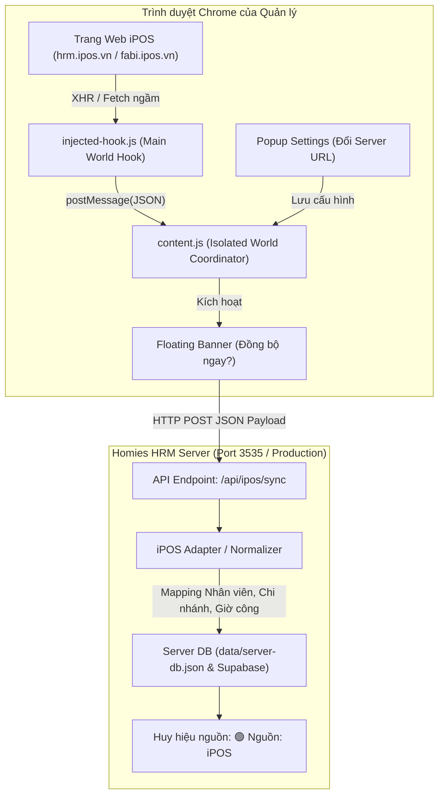

# Bản Đặc Tả Thiết Kế: Tiện Ích Đồng Bộ Tự Động iPOS HRM Sang Homies HRM (Homies iPOS Bridge)

- **Ngày lập:** 02/10/2026
- **Mã hệ thống:** EXT-IPOS-BRIDGE-01
- **Trạng thái:** Chờ phê duyệt từ User

---

## 1. Mục Tiêu & Bối Cảnh (Context & Goals)

### 1.1 Bối cảnh
Chuỗi Homies Milk Tea sử dụng hệ sinh thái iPOS (`hrm.ipos.vn` và `fabi.ipos.vn`) để vận hành máy chấm công vân tay, bảng xếp ca, tính công giờ và theo dõi doanh thu bán lẻ / hao hụt kho IVT. Hiện tại việc lấy số liệu qua Homies HRM đang dựa trên việc tải file Excel thủ công hoặc nạp dữ liệu tĩnh.

### 1.2 Mục tiêu nghiệp vụ
- Xây dựng **Tiện ích trình duyệt (Chrome Extension Manifest V3)** chạy nhẹ nhàng trên trình duyệt của Quản lý / Chủ chuỗi.
- Tự động phát hiện và trích xuất dữ liệu sạch (dạng JSON) khi người dùng mở các trang Chấm công, Bảng lương, Danh sách nhân viên, Báo cáo doanh thu/kho trên iPOS.
- Cung cấp trải nghiệm **1 chạm** (Smart Banner Toast): Hỏi xác nhận và gửi dữ liệu về Homies HRM mà không cần tải file Excel về máy.
- Xây dựng **Bộ phiên dịch thông minh (iPOS Adapter)** tại Homies HRM để tự động giải mã, chuẩn hóa các trường khác biệt về database và lưu trữ an toàn vào hệ thống Homies.

---

## 2. Kiến Trúc Tổng Thể (System Architecture)



---

## 3. Chi Tiết Các Thành Phần (Component Specifications)

### 3.1 Tiện ích Chrome: `extensions/homies-ipos-bridge/`
- **`manifest.json` (Manifest V3):**
  - Quyền truy cập (`host_permissions`): `*://*.ipos.vn/*`, `*://*.fabi.vn/*`, `*://localhost/*`.
  - Quyền trình duyệt (`permissions`): `storage`, `activeTab`.
  - Đăng ký `content_scripts` và `web_accessible_resources` cho `injected-hook.js`.
  - Cung cấp icon đủ kích thước (`16x16`, `48x48`, `128x128`).
- **`injected-hook.js` (Chạy trong Main World):**
  - Ghi đè an toàn (Monkey patch) `window.fetch` và `XMLHttpRequest.prototype.open/send`.
  - Chỉ lọc các URL liên quan đến HRM/Chấm công/Lương/Báo cáo iPOS (ví dụ: các API trả về danh sách nhân viên, bảng công tháng, lương chu kỳ).
  - Không can thiệp hay sửa đổi request gốc của iPOS; chỉ tạo bản sao `response.clone().json()` và gửi sang `content.js` thông qua `window.postMessage`.
- **`content.js` (Chạy trong Isolated World):**
  - Nhận tin nhắn từ `injected-hook.js`.
  - Nhận diện loại dữ liệu:
    - `attendance`: Bảng chấm công theo giờ / theo ca.
    - `payroll`: Bảng lương theo chu kỳ.
    - `employees`: Hồ sơ danh sách nhân viên.
    - `pos_revenue` / `inventory_lost`: Doanh thu và tỷ lệ hao hụt kho.
  - Hiển thị thanh thông báo nổi (Smart Floating Banner) góc trên màn hình:
    - *“⚡ Homies Bridge: Phát hiện dữ liệu [Loại] [Chi nhánh/Kỳ] • [Đồng bộ ngay] • [✕ Bỏ qua]”*.
  - Khi người dùng bấm `[Đồng bộ ngay]`, đọc Server URL từ `chrome.storage.local` (mặc định `http://localhost:3535`) và gửi `POST /api/ipos/sync`.
- **`popup.html` & `popup.js` (Bảng điều khiển tiện ích):**
  - Kiểm tra trạng thái máy chủ Homies HRM (Health check `GET /api/ipos/sync`).
  - Ô nhập địa chỉ Server URL (dễ dàng đổi từ localhost sang URL online).
  - Nút bấm *"Đồng bộ nhanh trang hiện tại"* và *"Lịch sử đồng bộ gần đây"*.

---

### 3.2 Cổng Tiếp Nhận & Bộ Phiên Dịch: `src/app/api/ipos/sync/route.ts`

- **Đầu vào (Payload nhận từ Extension):**
```json
{
  "source": "ipos_hrm",
  "module": "attendance" | "payroll" | "employees" | "pos_revenue" | "all",
  "store_raw_code": "HBP",
  "period": "2026-08",
  "raw_data": [ ... ],
  "timestamp": "2026-10-02T22:30:00.000Z"
}
```

- **Bộ phiên dịch dữ liệu (`src/lib/services/ipos/ipos-normalizer.ts`):**
  1. **Khớp chi nhánh (Store Mapping):**
     - Quy đổi `'HBP'` hoặc `'Hồ Bá Phấn'` -> `'store-001'`
     - Quy đổi `'429'` hoặc `'429 Lê Văn Sỹ'` -> `'store-002'`
     - Nếu có chi nhánh mới: Tự động ghi nhận mã chi nhánh mới.
  2. **Khớp mã nhân sự (Employee Mapping):**
     - Ghép theo `employee_code` (ví dụ `BH-9852`, `NV0008`).
     - Nếu mã chưa có trong Homies: Tự động tạo bản ghi nhân viên mới với đầy đủ tên, chức vụ, chi nhánh và số tài khoản ngân hàng từ iPOS.
  3. **Chuẩn hóa Bảng chấm công (Attendance Normalization):**
     - Chuyển đổi giờ vào, giờ ra, số giờ công, số ca thành đối tượng `AttendanceRecord` chuẩn của Homies.
  4. **Chuẩn hóa Bảng lương (Payroll Normalization):**
     - Đưa số giờ công (`regular_hours`), mức lương giờ (`hourly_rate`), tạm ứng (`deductions`), thưởng (`bonus`) vào phiếu lương chu kỳ tương ứng.
  5. **Bảo toàn dữ liệu độc quyền:**
     - Giữ nguyên các điểm trừ kỷ luật KPI, thưởng BSC, hợp đồng lao động đã có sẵn trên Homies HRM; chỉ cập nhật bổ sung số liệu giờ công và lương thực tế.

---

### 3.3 Đánh Dấu Nguồn & Giao Diện (UI Badging)
- Các phiếu lương hoặc bảng chấm công được đồng bộ từ iPOS sẽ có trường:
  - `source: 'ipos'`
  - `synced_at: '2026-10-02T...'`
- Trên giao diện Bảng Chấm Công (`/attendance`) và Bảng Lương (`/payroll`), hiển thị huy hiệu nhỏ:
  - `🟢 Nguồn: iPOS (Đồng bộ lúc 22:30)` kèm tooltip thời gian chi tiết.

---

## 4. Xử Lý Lỗi & An Toàn Dữ Liệu (Error Handling & Edge Cases)

1. **Máy chủ Homies chưa bật hoặc sai cổng:**
   - Tiện ích bắt lỗi `Network Error` và báo rõ: *“Không thể kết nối đến http://localhost:3535. Vui lòng kiểm tra dev server hoặc cập nhật link server trong cài đặt tiện ích.”*
2. **Trùng lặp dữ liệu (Idempotency):**
   - Áp dụng cơ chế **Upsert** (cập nhật nếu đã có, thêm mới nếu chưa có). Khi người dùng bấm đồng bộ nhiều lần trong ngày, hệ thống sẽ cập nhật số liệu mới nhất chứ không bị nhân đôi dòng.
3. **iPOS thay đổi tên API nội bộ:**
   - Bộ hook có cơ chế quét thông minh theo cấu trúc dữ liệu trả về (nếu JSON có chứa `employeeCode` hoặc `shiftId` thì tự nhận diện là bảng chấm công/nhân sự mà không phụ thuộc cứng vào URL).

---

## 5. Kế Hoạch Kiểm Thử (Testing & Verification)

1. **Kiểm thử API Endpoint `/api/ipos/sync`:**
   - Dùng script Node.js gửi payload mẫu iPOS thật tháng 8/2026 của chi nhánh HBP vào endpoint.
   - Xác nhận dữ liệu được lưu đúng vào DB và bảng lương hiển thị khớp 100% số liệu.
2. **Kiểm thử Tiện ích Chrome:**
   - Tải tiện ích vào Chrome qua chế độ Developer Mode (`Load unpacked`).
   - Mở web iPOS thử nghiệm để kiểm tra popup và thanh thông báo nổi.
3. **Kiểm thử tích hợp hệ thống:**
   - Chạy `npm run ai:guard` và `node scripts/test-bsc-flow.mjs` bảo đảm 10/10 test case tiếp tục pass.
